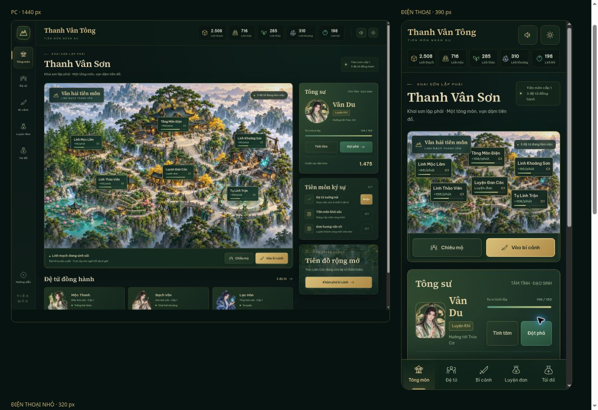

# Kiểm tra giao diện v1.1

Kiểm tra trên bản đã triển khai GitHub Pages, bằng Chrome trong các iframe có viewport thật. Tham số `preview=1` không ghi đè tiến trình người chơi.

| Bố cục | Viewport | Kết quả |
| --- | --- | --- |
| PC | 1440 px | Không tràn ngang; bản đồ và thẻ tông sư hiển thị song song |
| Điện thoại | 390 px | Không tràn ngang; điều hướng ở đáy; tông sư nằm ngay dưới bản đồ |
| Điện thoại nhỏ | 320 px | Không tràn ngang; đủ 6 nút công trình, không còn nút chồng nhau |

Thao tác kiểm tra trực tiếp: mở chiêu mộ, dùng hai lệnh miễn phí, xem thẻ đệ tử, tu luyện tăng cấp, chuyển sang bí cảnh, xuất chiến và đổi tốc độ trận đấu. Sân đấu hiển thị đủ 10 nhân vật mà không tràn ngang.

19 kiểm tra logic và các bước kiểm tra / triển khai GitHub Actions đều đạt. Các bản lưu phiên bản 1.0 dùng tiếp trong phiên bản 1.1.

Đây là kiểm tra bố cục bằng Chrome, không phải thử nghiệm trên thiết bị iPhone hoặc Android thật. Bản xem bố cục: [responsive-preview.html](https://caovanhanhtp2891-lab.github.io/tutienvandao/responsive-preview.html).

